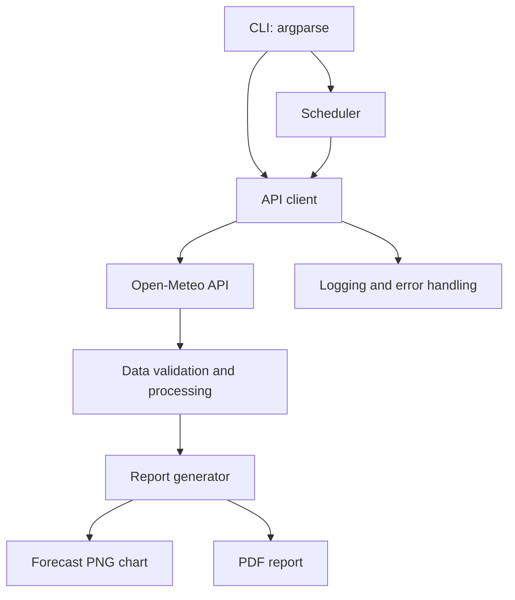

# Enterprise Python Automation Capstone

A packaged Python CLI application that retrieves public weather data from Open-Meteo, validates and processes the response, creates a temperature chart, and generates a PDF report. It supports recurring execution, structured logging, and automated tests.

## Features

- Public API integration (Open-Meteo; no API key required for ordinary non-commercial use)
- Input validation and clear error messages
- Summary metrics and three-day forecast table
- Matplotlib chart and ReportLab PDF output
- CLI commands via `argparse`
- Optional recurring scheduler
- File and console logging
- `pytest` tests
- Installable Python package using `pyproject.toml`

## Architecture



## Requirements

- Python 3.10 or newer
- Internet connection for API data
- Windows, macOS, or Linux

## Setup (Windows)

```cmd
python -m venv .venv
.venv\Scripts\activate
python -m pip install --upgrade pip
pip install -e ".[dev]"
```

If PowerShell blocks activation, use Command Prompt, or run the environment's Python directly.

## Usage

Generate a report using the default coordinates for Chennai:

```cmd
enterprise-report generate
```

Specify a location and output file:

```cmd
enterprise-report generate --latitude 13.0827 --longitude 80.2707 --output reports/chennai_report.pdf
```

You can also run without installing the CLI entry point:

```cmd
python -m enterprise_automation.cli generate --output reports/weather_report.pdf
```

Run a report immediately and repeat every 30 minutes:

```cmd
enterprise-report schedule --every-minutes 30
```

Stop the scheduler with `Ctrl+C`. Scheduled mode runs a report immediately before waiting for the next interval.

## Output

- `reports/weather_report.pdf`: readable PDF with current conditions, a forecast chart, and a forecast table
- `reports/weather_report_forecast.png`: companion chart
- `logs/automation.log`: execution history

Output files are generated locally and excluded from Git by `.gitignore`.

## Tests

```cmd
pytest -v
```

Tests cover successful data processing, invalid payloads, missing values, and PDF/chart file creation. Tests do not require an internet connection.

## Example execution log

A successful run should end with a message similar to:

```text
INFO | enterprise_automation.report_generator | PDF report saved to .../reports/weather_report.pdf
Report created successfully: .../reports/weather_report.pdf
```

Actual output depends on the machine, current API response, and chosen output path. Capture your own execution logs for the capstone submission.

## Troubleshooting

- **Network/API failure:** check your internet connection and retry later.
- **`enterprise-report` is not recognized:** activate `.venv` and run `pip install -e ".[dev]"`; alternatively use `python -m enterprise_automation.cli generate`.
- **No module named package:** run commands from the repository root after activating the environment and installing the package.
- **PDF missing:** check the terminal for errors and verify the output path.

## Suggested mentor submission

1. GitHub repository containing the source code, tests, README, and `pyproject.toml`.
2. A successful PDF report and terminal execution log.
3. A 2–4 minute walkthrough explaining the architecture, running the CLI, opening the PDF, and running the tests.

## Project limitations

This is an educational capstone, not a mission-critical forecasting service. API availability and forecast values can change. For commercial deployments, review the API provider's terms, add monitoring and retry/backoff policies, and run scheduling through an operating-system service or job scheduler.
